## Why does location matter?

**Why are archaeological things where they are?**

{fig-align="center" width="75%" .img-card}

::: {.caption}
Aerial photograph: Steve Jurvetson,
[CC BY 2.0](https://creativecommons.org/licenses/by/2.0/).
:::

::: notes
~2 min. Begin with a landscape or Angkor map. Ask what we can learn from the positions and spatial relationships of material traces. The goal is not simply making maps.
:::

---

## From maps to explanations

::: {.center-block}
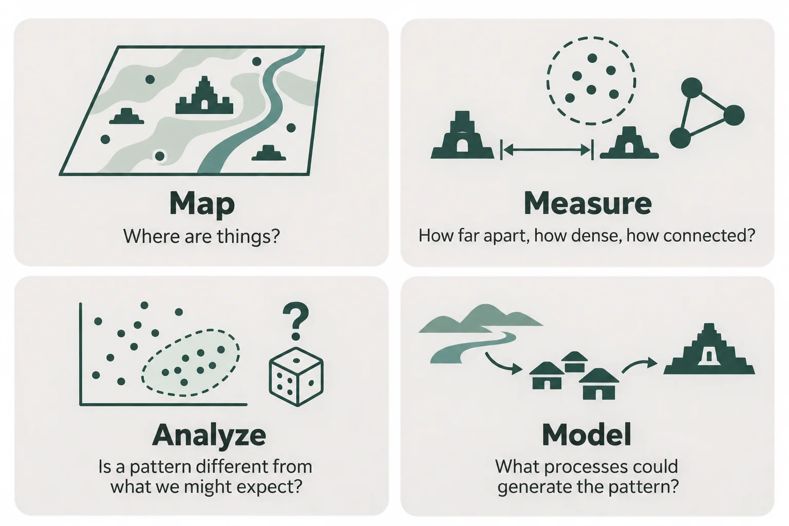{width="95%" fig-align="center"}
:::

::: {.callout-card}
**GIS is a framework for representing, manipulating, and analysing geographically referenced information.**
:::

::: notes
~2 min. Distinguish describing an archaeological pattern from explaining its origin. Maps are outputs, not the whole discipline.
:::

---

## Spatial Thinking in Early London

:::: {.columns}
::: {.column width="50%"}
**John Snow: cholera in Soho, 1854**

- Mapped **cholera deaths** alongside **public water pumps**.
- Recognised a concentration of deaths around the **Broad Street pump**.
- Investigated **where people obtained their water**, including cases that did not fit a simple proximity pattern.
- Combined spatial patterns and household evidence to argue for **waterborne transmission**.
:::
::: {.column width="50%" .h-center}
{fig-alt="Historical street map of Soho, with stacks of black bars marking deaths and labelled public water pumps; deaths concentrate around Broad Street." height=560 fig-align="center" .img-card}

::: {.reference}
[Image: John Snow, via Wikimedia Commons](https://commons.wikimedia.org/wiki/File:Snow-cholera-map-1.jpg) · Public domain.
:::
:::
::::

::: {.callout-card}
**Locations + relationships + contextual evidence → an explanation to investigate.**
:::

::: {.reference}
[Snow's 1855 account and map, via UCLA](https://epi-snow.ph.ucla.edu/Stream2_BSPoutbreak_a.html)
:::

::: notes
~2–3 min. Suggested story:

**Setting.** London, late summer 1854. Cholera caused a sudden, deadly outbreak in Soho around Broad Street, now Broadwick Street. John Snow was a physician and anaesthetist who favoured waterborne transmission over the widely held explanation of miasma, or unhealthy air. He approached the outbreak with a hypothesis already in mind.

**Investigation.** Snow obtained registered death addresses and questioned households about drinking water. Many deaths occurred near the Broad Street pump, but proximity alone was insufficient: people could choose a more distant pump or have water brought to them. In his account, several people who lived nearer other pumps nevertheless preferred Broad Street water.

**The memorable exceptions.** A woman living in Hampstead had Broad Street water delivered because she liked its taste; she and a visiting niece who drank it died. Conversely, the nearby workhouse had its own water supply and relatively few deaths. Brewery workers also largely avoided the pump water. These contrasts helped distinguish actual exposure from merely living nearby. Choose one example to tell aloud.

**Action and limits.** Snow brought his findings to the parish authorities on 7 September; the handle was removed on 8 September. The outbreak was already declining, and many residents had fled. Do not say that removing the handle instantly stopped the epidemic or that the map alone proved causation. His explanation did not immediately win general acceptance.

**How to read this image.** The black marks are bars representing deaths at addresses, not dots representing infections. Locate Broad Street and its pump, then indicate the surrounding stacks of bars. Snow first presented a map publicly in December 1854; this version appeared in the second edition of On the Mode of Communication of Cholera in 1855. It communicates evidence assembled through investigation, rather than recording a single moment of discovery. Snow also studied differences in mortality between households supplied by different water companies elsewhere in London: his argument extended beyond this one neighbourhood.

**Teaching link.** Ask: would assigning every household to its nearest pump recover actual water use? Bring this back to archaeology: a settlement near a river is a spatial observation; explaining that relationship requires evidence about behaviour and historical conditions.

Sources for retelling: [Snow's 1855 account, pp. 38–55](https://epi-snow.ph.ucla.edu/Stream2_BSPoutbreak_a.html); [UCLA on the map's chronology and later retellings](https://epi-snow.ph.ucla.edu/Stream2_BSPoutbreak_f.html); [CDC historical summary](https://www.cdc.gov/mmwr/preview/mmwrhtml/mm5334a1.htm).
:::

---

## Brief History of GIS in Archaeology

:::: {.columns}
::: {.column width="55%"}
**Changing ways of thinking about space**

| Rough period | Main emphasis |
|:--|:--|
| **Before the 1940s** | Map sites and artefact distributions; trace cultural regions and connections. |
| **1940s–1950s** | **Regional settlement patterns:** Gordon Willey's Virú Valley survey, Peru (1946; published 1953), relates settlements to environment and social organisation. |
| **1960s–1970s** | **Quantitative spatial analysis:** measure clustering, catchments, and relationships between sites. |
| **1980s–present** | **Digital GIS:** integrate layers and model landscapes, movement, and visibility; debate how space was experienced and understood. |
:::
::: {.column width="45%" .h-center}
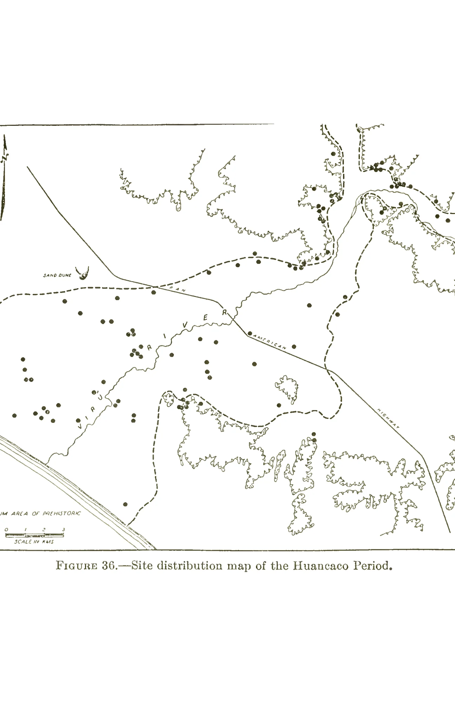{fig-alt="Willey's Huancaco-period site distribution map: site symbols across the Virú Valley alongside the river and surrounding terrain." height=600 fig-align="center" .img-card}

**Gordon Willey: the region as a unit of study**
:::
::::

::: {.reference}
[Willey, 1953](https://repository.si.edu/bitstream/handle/10088/15450/bulletin1551953smit.pdf?sequence=1&isAllowed=y) · [Conolly & Lake, spatial analysis](https://www.cambridge.org/core/books/abs/geographical-information-systems-in-archaeology/spatial-analysis/58F8744ECB511B22CBE7B5CA26440F93) · [Hu, landscape archaeology and GIS](https://student-journals.ucl.ac.uk/pia/article/id/212/)
:::

::: notes
~2 min. These are overlapping trends, not a universal sequence in which each approach replaced the last. Spatial thinking predates digital GIS. Willey's 1946 fieldwork and 1953 monograph, Prehistoric Settlement Patterns in the Virú Valley, Perú, are a landmark rather than the invention of regional survey: settlement locations, forms, and relationships could illuminate whole societies. Quantitative methods grew with processual archaeology; later landscape approaches also asked about perception, meaning, and lived experience. The final row compresses several decades of parallel developments.

The image is Willey's figure 36, “Site distribution map of the Huancaco Period” (p. 179). Point out the site symbols, river, and terrain: the object of study is a regional arrangement of sites in a landscape. This is a period-specific distribution, rather than a map of every site from every period. Comparing such distributions makes changes in settlement organisation an archaeological question. A shared period assignment does not establish that every mapped site was occupied at exactly the same time. Ask: what might we learn from the relationships between sites that we could not learn by excavating just one?
:::

---

## The Virú Valley: sites in a landscape

::: {.center-block}
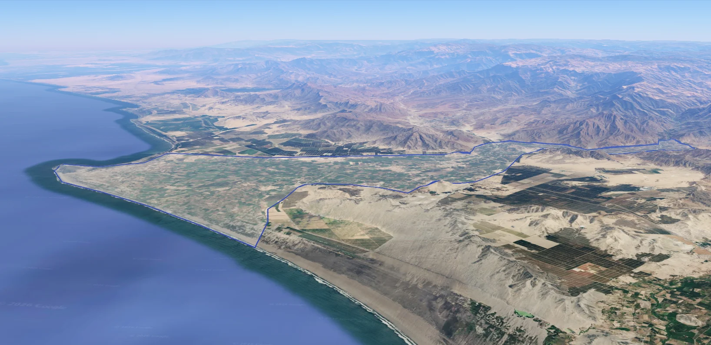{fig-alt="Oblique Google Earth view of the Virú Valley, with the Pacific coast to the left, cultivated land across the valley floor, and dry hills rising inland." height=620 fig-align="center" .img-card}
:::

**How might terrain and access to water shape the distribution of settlements?**

::: notes
~1 min. Return briefly to Willey's question of regional settlement patterns. Point out the Pacific coast, the broad cultivated valley floor, and the hills enclosing and dividing the landscape. Ask students to connect this view with the site distribution on the previous slide: where might farming, routes, and settlement have been possible, and what evidence would we need to explain particular locations?

This is a modern Google Earth view, not a reconstruction of the Huancaco-period landscape. The visible fields, roads, and land use should not be projected unchanged into the past. Use the image to orient students to the terrain; Willey's period-specific map provides a different kind of evidence. The blue outline is a display overlay, not an established ancient boundary. The views have different orientations and perspectives, so do not imply an exact visual overlay of the two images.
:::

---

## SPATIAL DATA {.section-slide background-image="../assets/branding/section_bg.png" background-size="cover" background-position="center"}

---

## Two fundamental representations

::: {.center-block}
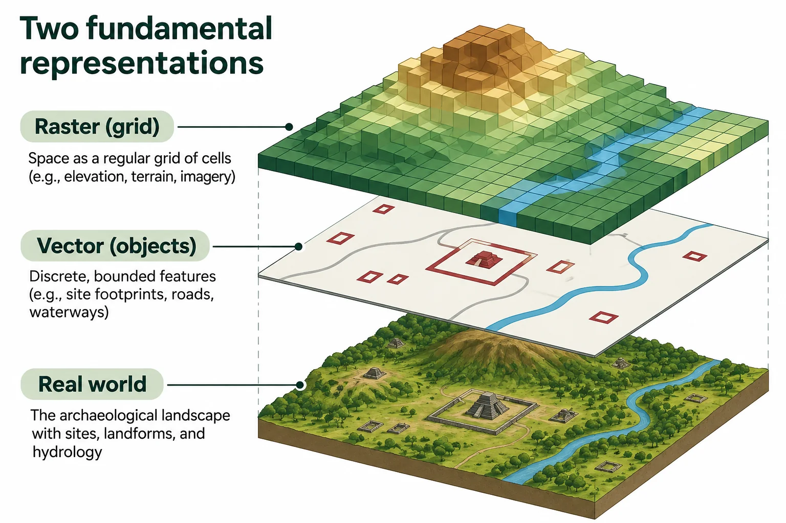{fig-alt="An archaeological landscape represented as a raster grid of terrain values and as vector features for sites, roads, and waterways." height=740 fig-align="center" .nostretch}
:::

::: notes
~1 min. Read the graphic from the landscape at the bottom to the two representations above. Raster divides space into cells with values; vector represents selected features with geometries. These are alternative ways of representing the same landscape and can be used together. The raised raster blocks illustrate elevation values, not literal cubes stored in a typical elevation raster. Preview the next two slides: first the grid, then the objects.
:::

---

## Raster: a grid of values

:::: {.columns}
::: {.column width="40%"}
- Space is divided into **rows and columns of cells**.
- Each cell stores a **value per band**: elevation, reflectance, or a land-cover code.
- **Cell size** determines the spatial resolution.
- **NoData** marks missing or undefined values.

**Archaeological uses:** terrain models, satellite imagery, and geophysical survey grids.
:::
::: {.column width="60%" .h-center}
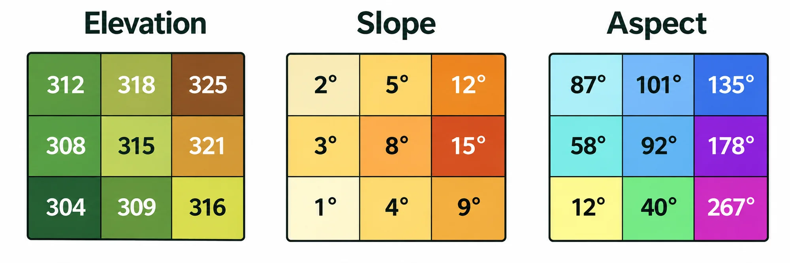{fig-alt="Three illustrative three-by-three raster grids showing elevation values, slope angles, and aspect directions." width="100%" fig-align="center" .nostretch}
:::
::::

::: {.callout-card}
**A cell value represents an area at a chosen resolution. Zooming in does not add detail.**
:::

::: notes
~2 min. The graphic shows illustrative elevation, slope, and aspect grids. Point to one cell: its position comes from the grid's geographic reference, while its value depends on the variable represented. Elevation describes height relative to a reference surface; slope describes steepness; aspect describes the direction a slope faces, commonly measured clockwise from north. Slope and aspect can be derived from an elevation raster using neighbouring cells. Treat the numbers as schematic examples, not a verified calculation of slope and aspect from the nine elevations shown. No cell size is specified in this graphic.

A raster can represent continuous quantities such as elevation or discrete classes such as land cover; raster does not mean continuous data only. A colour image commonly has several bands, such as red, green, and blue, with a value in each band for each cell. NoData is not the same as zero: zero elevation can be a valid measurement. Cell values may come from measurements, interpolation, or processing; they need not be exact averages over the cell. Finer cells do not automatically mean greater accuracy.
:::

---

## Raster coordinates and resolution

- **Location:** a CRS and the grid's origin, orientation, and cell size locate each row and column on Earth.
- **Resolution:** cell width and height in coordinate units; a **10 × 10 m** cell covers **100 m²**.
- **Extent:** the geographic area covered by the whole grid.

.](../assets/content/01-geospatial-archaeology/pixelsizeconcept.jpg){fig-alt="A shape represented with progressively smaller raster cells, illustrating how finer resolution follows its boundary more closely." height=440 fig-align="center" .img-card}

::: notes
~2 min. A row and column identify a position within an array, but do not by themselves identify a geographic location. GIS uses the grid's georeferencing together with its coordinate reference system to place the cells. We will discuss CRSs more fully later. For a simple north-up projected grid, start at its upper-left corner: moving one column advances one cell width east; moving one row advances one cell height south. The first cell centre lies half a cell width and half a cell height inside that corner. A cell's elevation or land-cover value is separate from these location coordinates.

Resolution is expressed in the CRS's units. In a projected CRS those units may be metres; in a longitude/latitude grid they are degrees, and a degree of longitude spans different ground distances at different latitudes. Do not assume all raster cell sizes are metres or that cells must be square. For a north-up grid, columns multiplied by cell width give its total coordinate width, and rows multiplied by cell height give its height.

Use the image to compare how coarser and finer grids represent the same boundary. It is a schematic illustration: the drawn grid densities are not a numerically scaled demonstration of the labelled 30 m, 10 m, and 1 m ratios. A finer grid can represent smaller details when the source data support them. Resampling a coarse raster to smaller cells does not create new observations or improve its underlying positional accuracy. Distinguish cell size, total extent, and accuracy. A large raster can cover a small area finely or a large area coarsely.

Image hosted by Open Spatial Science; the caption links directly to the supplied source image. Background on resolution: [QGIS, Raster Data](https://docs.qgis.org/3.44/en/docs/gentle_gis_introduction/raster_data.html).
:::

---

## Vector: features with geometry

:::: {.columns}
::: {.column width="40%"}
- **Point:** a findspot or settlement location.
- **Line:** a road, wall, or waterway.
- **Polygon:** a building footprint or survey area.

Coordinates define the geometry; **attributes** describe the feature.

**Geometry is a modelling choice:** a point may represent an entire settlement; a crisp polygon may represent an uncertain boundary.
:::
::: {.column width="60%" .h-center}
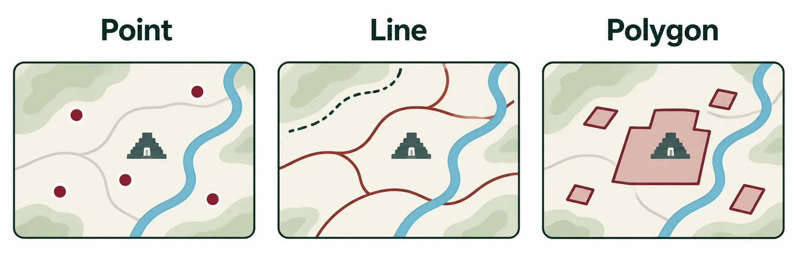{fig-alt="Three schematic maps illustrating vector geometry: points marking locations, lines tracing routes, and polygons enclosing areas around archaeological features." width="100%" fig-align="center" .nostretch}
:::
::::

::: {.callout-card}
**Choose a representation that fits the question, scale, and available evidence.**
:::

::: notes
~2 min. A point does not imply that a settlement has no area; it may be all that a regional inventory records. The same settlement might be represented by a point at regional scale and a polygon in a detailed survey. A line follows a road's course but does not necessarily preserve its width. Polygon boundaries can be inferred or uncertain despite their crisp appearance. Vector can also represent contours or zones derived from continuous phenomena, so avoid equating vector exclusively with naturally bounded objects. Each feature can carry attributes such as site ID, period, or confidence: this leads directly to the next slide's table. Raster and vector describe data structures, not levels of quality; the useful choice depends on what we want to measure.
:::

---

## Vector coordinates: from locations to shapes

::: {.center-block}
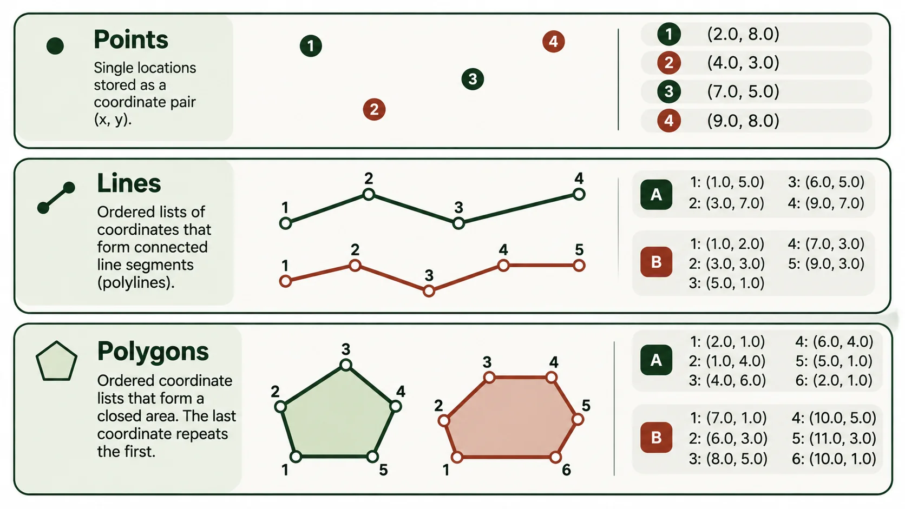{fig-alt="Diagram of points stored as coordinate pairs, lines as ordered sequences of vertices, and polygons as closed rings, with illustrative coordinate lists." height=650 fig-align="center" .nostretch}
:::

::: {.callout-card}
**Coordinates define the shape; a coordinate reference system places it on Earth.**
:::

::: notes
~2 min. Start at the top: a two-dimensional point is one coordinate pair. The numbers are illustrative, with no geographic CRS specified. In a common projected x/y convention, x is easting and y is northing; coordinate order and units must be checked against the dataset's CRS and format. Some geometries also store a z coordinate, but keep the discussion here in two dimensions.

In the middle panel, each numbered vertex has a coordinate pair. The ordered sequence tells GIS which vertices to connect. Changing the order can change the path even if all the coordinates remain the same. The numbered circles mark vertices within a feature; they are not necessarily separate point features with separate attribute rows. A typical polyline joins successive vertices with straight segments, allowing a winding road to be approximated by many short segments.

At the bottom, a polygon encloses an area using a closed ring. In many common encodings, the last coordinate repeats the first to close the ring. The green polygon's list demonstrates that repetition. The orange polygon's list shows six distinct vertices but omits the repeated starting coordinate: explain that the closing segment back to vertex 1 is required, and an explicitly closed coordinate list would append (7.0, 1.0). Treat the drawings as schematic, not as precisely scaled coordinate plots. Polygons can also contain holes or several parts, which we do not need to cover in detail here.

More vertices can describe a boundary in greater detail, but do not guarantee that it was measured accurately. Contrast vector storage of explicit vertex coordinates with the raster grid's origin, cell size, and row/column positions. Both need a spatial reference. Then move to the attributes slide: coordinates tell us where a feature is and its shape; the associated table tells us what we know about it.
:::

---

## Attributes: the other half of GIS

| site_id | period | ceramics | confidence |
|:--|:--|--:|:--|
| A01 | Early medieval | 143 | High |
| A02 | Uncertain | 28 | Low |
| A03 | Late medieval | 79 | Medium |

- **Geometry** locates a feature.
- **Attributes** describe it.
- Each row usually corresponds to a feature; columns store variables.

::: notes
~2 min. The table is illustrative, not a real dataset. Explain that we can select, colour, filter and analyse mapped features using attributes. Mention missing values.
:::

---

## Conversions

:::: {.columns}
::: {.column width="45%"}
**Vector → raster: rasterise**

- Assign feature attributes to grid cells.
- Choose **cell size**, grid alignment, and an assignment rule.
- Example: turn land-use polygons into a categorical grid.

**Raster → vector: polygonise**

- Trace regions of connected cells with the same value.
- Example: turn a classified land-cover raster into polygons.
- Boundaries inherit the **cell edges**.
:::
::: {.column width="55%" .h-center}
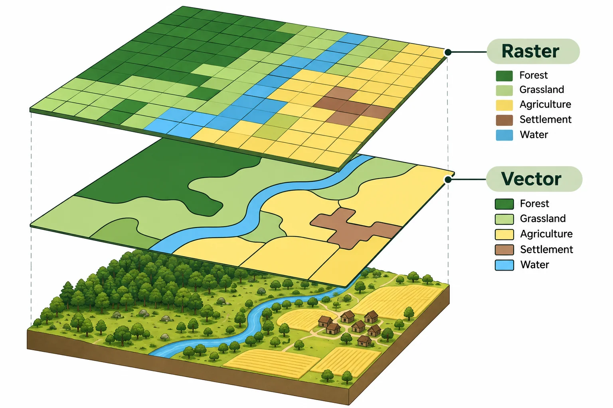{fig-alt="The same landscape represented as land-cover polygons and a categorical raster, with forest, grassland, agriculture, settlement, and water classes." height=620 fig-align="center" .nostretch}
:::
::::

::: {.callout-card}
**Conversion changes the representation; it does not recover lost spatial detail.**
:::

::: notes
~2 min. Use the graphic as a conceptual comparison of two representations of the same landscape. The vector panel has smooth boundaries, but simply polygonising the raster shown would produce boundaries along the grid cells. Smooth outlines require an additional generalisation or smoothing step; they are not recovered automatically from the raster.

For vector to raster, imagine assigning a land-cover category to each cell from the polygons. Cells can cross several boundaries: the result depends on the chosen rule, such as using the cell centre or including every cell touched by a feature. Grid alignment matters as well as cell size. Small settlements and narrow waterways may disappear or become exaggerated at coarse resolution. Overlapping features also require a decision about which value to retain.

For raster to vector, polygonisation groups connected cells with matching category values and carries those values into polygon attributes. The connectivity rule affects whether cells meeting only at corners form one region. A noisy classification may create many small polygons. This example concerns categorical rasters: polygonising raw elevation values is usually not a useful way to represent terrain. Contour extraction is another raster-to-vector operation, and produces lines of equal elevation; interpolation from vector measurements to a raster surface is another distinct operation, not simply the inverse of polygonisation.

Converting a polygon to a coarse raster and back will generally not reproduce its original boundary. Ask students which details in the pictured settlement or river might be lost as the grid becomes coarser. Choose the conversion to serve the analysis, and check its effect on areas, boundaries, and small features.
:::

---

## Conversions: what happens at the edges?

:::: {.columns}
::: {.column width="40%"}
- A vector boundary can **cross a cell**; a categorical raster assigns a class to the **whole cell**.
- **Cell size** controls how closely the grid can follow a boundary.
- **Grid alignment and assignment rules** affect which cells receive each class.
- Narrow features may **disappear or widen**; measured areas and boundaries can change.
:::
::: {.column width="60%" .h-center}
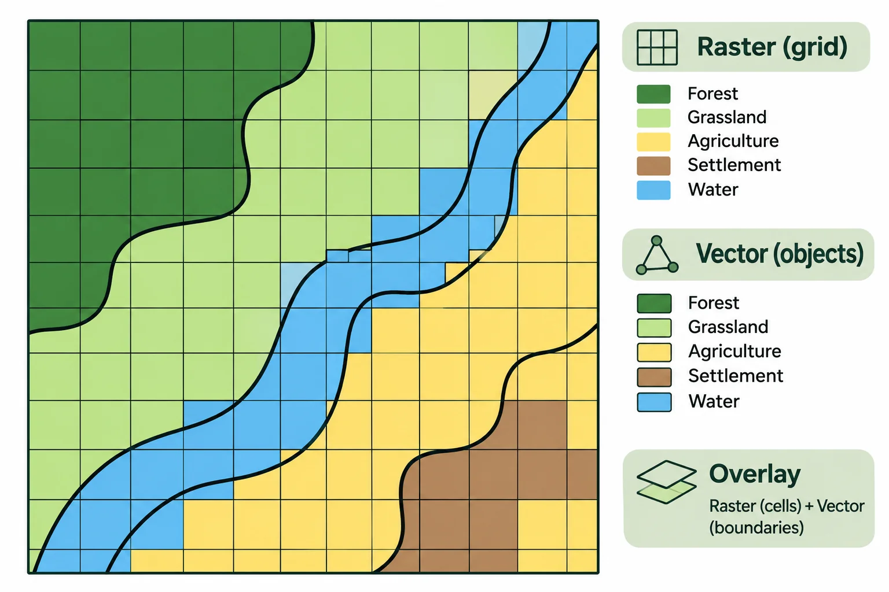{fig-alt="Smooth vector land-cover boundaries superimposed on a categorical raster grid over the same area, showing mismatches between cell edges and forest, river, field, and settlement boundaries." height=620 fig-align="center" .nostretch}
:::
::::

::: {.callout-card}
**A smoother-looking output does not necessarily contain more spatial information.**
:::

::: notes
~2 min. Both representations cover the same area. In the graphic, follow a thick black vector boundary where it crosses the thin grid lines, then compare it with the stepped edges of the coloured raster classes. A cell straddling forest and grassland still needs one category under a single-class raster model. The graphic is schematic and does not specify one consistent rasterisation rule; use it to illustrate the mismatch rather than infer the exact algorithm.

Imagine making the cells larger: small patches and bends in the river become harder to preserve. Moving the grid origin while keeping cell size fixed can also change which cells capture a narrow feature. A centre-based assignment can miss a feature between cell centres, whereas including every touched cell can widen it. Ask students to identify a river bend or settlement edge where the two representations disagree.

If we polygonise this categorical raster, the resulting boundaries initially follow its cell edges. Smoothing those polygons changes geometry; it cannot reconstruct the original boundary uniquely. Likewise, a display can interpolate raster colours to look smooth without increasing the source resolution. Vector curves are also approximations, often stored as connected straight segments, and a crisp line is not a guarantee of positional accuracy. The point is the information supported by the representation and evidence, rather than which image looks more polished.

Before conversion, decide what detail the question requires and choose an appropriate cell size, extent, grid alignment, and assignment rule. Afterwards, check small features and compare areas or distances relevant to the analysis. Align grids when combining raster layers.
:::

---

## Layers and files

:::: {.columns}
::: {.column width="52%"}
- **Layers** combine geographic information in a map.
- A layer may contain vector features or a raster.
- Common files: **GeoPackage**, **GeoJSON**, **GeoTIFF**, coordinate-bearing **CSV**.
- Older **Shapefiles** are still encountered, but have limitations.
- A **QGIS project** stores a map configuration; it is not necessarily a self-contained copy of the data.
:::
::: {.column width="48%" .h-center}
.](https://www.ordnancesurvey.co.uk/img-assets/media-components/01-GISLayers.x506ef346.jpg?w=3840&f=webp){fig-alt="Diagram illustrating geographic information organised into GIS layers." height=600 fig-align="center" .img-card}
:::
::::

::: notes
~2 min. Use the illustration to explain that layers organise different geographic information over a shared area. They are drawn in a chosen order; they are not physically separated surfaces in the landscape. A map can combine raster and vector layers when their spatial references are handled correctly.

Distinguish a displayed layer, its source data, and a saved project. One file can contain several datasets, as in a GeoPackage, and the same source can be displayed in several layers with different styling or filters. A QGIS project records sources and map configuration but does not necessarily bundle the data. Explain why a project can open with missing layers if source files move or paths change. Image source: Ordnance Survey; linked directly to the original image rather than the search-engine proxy.
:::

---

## COORDINATES AND PROJECTIONS {.section-slide background-image="../assets/branding/section_bg.png" background-size="cover" background-position="center"}

---

## Coordinates need a reference system

:::: {.columns}
::: {.column width="45%"}
- **Geographic coordinates:** longitude and latitude (angular units).
- **Projected coordinates:** positions on a flat map (often metres).
- A **coordinate reference system (CRS)** specifies how coordinates relate to the Earth.
:::
::: {.column width="55%" .h-center}
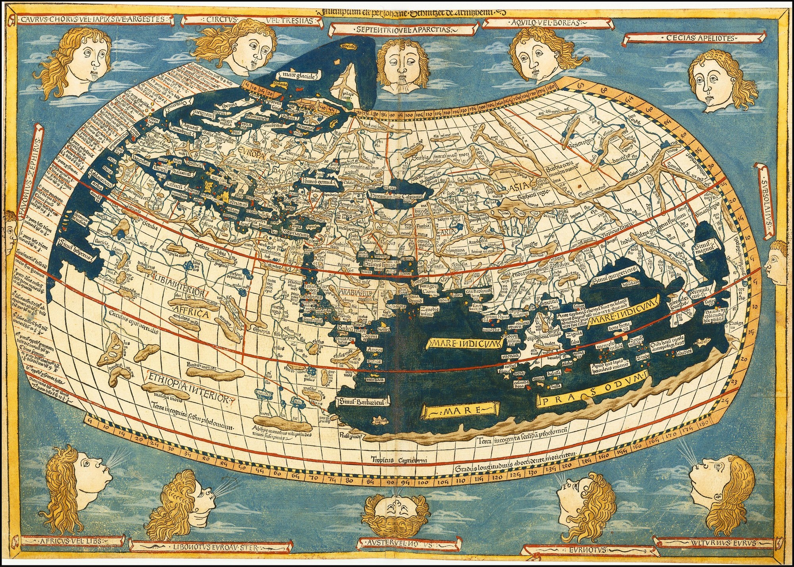{fig-alt="Hand-coloured Ptolemaic map of Europe, Africa, and Asia, surrounded by wind heads, with numbered latitude and longitude lines." height=540 fig-align="center" .img-card}

::: {.reference}
[Historical context: Library of Congress](https://www.loc.gov/exhibits/1492/mediterr.html)
:::
:::
::::

::: {.callout-card}
**A pair of numbers is not a usable location unless we know what coordinate system it belongs to.**
:::

::: notes
~2 min. Introduce WGS 84 geographic coordinates (EPSG:4326) and a locally appropriate projected UTM CRS. Explain that degrees are not metres.

Brief historical hook (~45 seconds): Claudius Ptolemy worked in Alexandria in the second century CE. His Geography brought together place coordinates and instructions for constructing maps using latitude and longitude. He built on earlier work rather than inventing geographic coordinates. The important connection here is the idea that locations can be recorded numerically and plotted within a shared framework.

This image is a much later printed interpretation: Johannes Schnitzer's world map for the 1482 Ulm edition, not a surviving map drawn by Ptolemy himself. Point out the numbered graticule, then Europe, Africa, and Asia. The wind heads are decorative; the coordinate grid does the locating. The map represents inherited geographic knowledge and contains substantial errors: systematic coordinates do not guarantee accurate positions. Its longitude reference also predates today's Greenwich convention. This is a historical precursor to coordinate-based mapping, not a modern CRS. Transition back to the practical question: what reference and units give our coordinate numbers meaning?

Historical sources: [Library of Congress, The Mediterranean World](https://www.loc.gov/exhibits/1492/mediterr.html); [University of Minnesota Bell Library, Ptolemy](https://apps.lib.umn.edu/bell/rmaps/1482_w.html). Image supplied through the user's link and saved locally for reliable display.
:::

---

## Why project the Earth?

- Earth is curved; maps and many GIS calculations use planes.
- Projections necessarily introduce **distortion**.
- Distortion can affect **area, shape, distance, or direction**.
- Choose a CRS appropriate to the **region and measurement**.

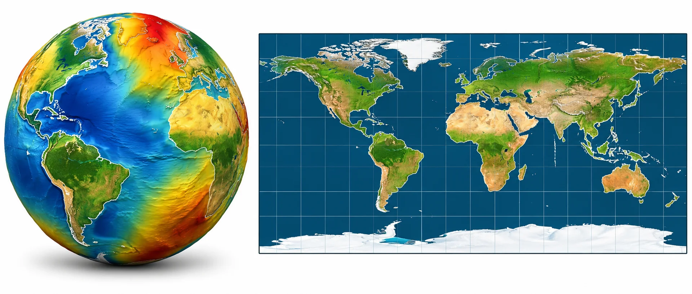{fig-alt="Illustrative comparison of Earth as a globe and as a flat world map with a coordinate grid." height=500 fig-align="center" .nostretch}

::: notes
~2 min. Mercator is visually familiar but distorts area. UTM is often useful for local or regional distance analysis; it is not a universal choice for every area or purpose.

Use the image to contrast a curved surface with a flat map. The globe's exaggerated relief and colours are illustrative: do not describe this as a measured geoid model or infer a particular projection from the artwork. The key point is that flattening Earth's curved reference surface requires compromises. Choose a projection for the region and the property we need to measure, and check the units before calculating distances or areas.
:::

---

## Mercator: useful properties, visible distortion

::: {.center-block}
.](../assets/content/01-geospatial-archaeology/mercator-britannica.jpg){fig-alt="Britannica diagram comparing a globe with a Mercator world map, showing increasingly separated parallels and enlarged high-latitude land areas." height=650 fig-align="center" .img-card}
:::

**Preserves local angles; greatly enlarges areas towards the poles.**

::: notes
~2 min. Follow the parallels from the globe to the map. Meridians become parallel vertical lines, and spacing between parallels increases towards the poles. Mercator is conformal: local angles and infinitesimal shapes are preserved, but area is not. Compare Greenland with Africa to make the enlargement at high latitudes tangible. Do not say that all distances or the shapes of whole continents are preserved.

Its historical advantage for navigation is that constant-bearing routes, or rhumb lines, appear straight. A straight route on this map is not generally the shortest route on Earth. This makes a useful example of choosing a projection for a particular task rather than judging it by appearance alone. For archaeology, raw map areas measured in Mercator can be seriously misleading, especially far from the equator.

The Britannica diagram is schematic: its outer labels say 90° N and S, but the actual Mercator projection cannot show the poles at a finite distance. The map must be truncated before them. Mention this briefly if students notice the labels; avoid presenting the image as a mathematically exact construction by projecting light from a globe.

Technical reference: [USGS, Map Projections—A Working Manual](https://pubs.usgs.gov/pp/1395/report.pdf), Mercator section.
:::

---

## Different projections, different compromises

::: {.center-block}
.](../assets/content/01-geospatial-archaeology/common-projections.png){fig-alt="Nine labelled world maps: Robinson, Plate Carrée, Winkel Tripel, Eckert IV, Mollweide, Mercator, Wagner VII, interrupted Mollweide, and Goode Homolosine." height=650 fig-align="center" .img-card}
:::

**Choose for the region and task: area, local shape, distance, or overall presentation.**

::: notes
~2 min. Do not walk through every name. Compare Mercator with Mollweide, then an uninterrupted map with an interrupted one. Mollweide preserves area but changes shapes. Robinson and Winkel Tripel are compromise projections for world-map presentation; they do not preserve all properties. Interrupted projections redistribute distortion by introducing cuts, which may be useful for showing land areas but inconvenient for tracing continuous routes.

Ask students to watch the graticule and the outline of the same continent across panels. A familiar-looking world map is not necessarily appropriate for calculating archaeological site areas or travel distances. These are small-scale world maps, not a menu of suitable CRSs for every local excavation or regional survey. For local analysis, choose an appropriate regional projection and check its intended use and distortion.

The source figure comes from a study of visual preferences and is arranged by descending map-reader preference, not by accuracy or analytical suitability. We are using it to compare representations, not to rank scientific quality. Extracted from the [authors' copy of the paper](https://berniejenny.info/pdf/2015_Savric_etal_UserPreferenceWorldMaps.pdf), figure 1.
:::

---

## Watch the projection change

::: {.center-block}
```{=html}
<video controls playsinline preload="none" width="1360" height="765" poster="https://svs.gsfc.nasa.gov/vis/a000000/a005000/a005090/projection_morph_comp.01000_print.jpg" aria-label="NASA animation morphing between map projections, with circles showing distortion">
<source src="https://svs.gsfc.nasa.gov/vis/a000000/a005000/a005090/projection_morph_comp_2160p59.94_2.webm" type="video/webm">
<source src="https://svs.gsfc.nasa.gov/vis/a000000/a005000/a005090/projection_morph_comp_2160p59.94_2.mp4" type="video/mp4">
<a href="https://svs.gsfc.nasa.gov/5090">Watch Map Projections Morph on NASA's website.</a>
</video>
```
:::

::: {.reference}
[Map Projections Morph](https://svs.gsfc.nasa.gov/5090) (2023). Credit: NASA's Scientific Visualization Studio. Visualization: Greg Shirah.
:::

::: notes
~1–2 min. Press play manually; the video streams from NASA and needs internet access. The source link below the player also opens NASA's page if playback fails. Ask students to track one continent and the overlaid circles as the projection changes. Each circle represents the same area on the globe, one million square kilometres, roughly the area of Egypt. Their changing shapes and sizes reveal how distortion varies across a map.

Pause briefly on a projection where circle areas remain similar but shapes change, then compare with Mercator, where circles grow strongly towards the poles. These finite circles illustrate distortion in the spirit of Tissot's indicatrices; no mathematics is needed. Some sequences also animate projection parameters, with the changing values shown in the lower left. The animation changes the representation, not Earth's geography. End by returning to the question: what property does our archaeological analysis need to preserve?

Source and explanation: [NASA SVS, visualization 5090](https://svs.gsfc.nasa.gov/5090).
:::

---

## Two operations students must not confuse

**Assign / define CRS**

> Tell GIS what the existing coordinate numbers mean.

**Reproject / transform**

> Calculate new coordinate numbers in a different CRS.

::: {.callout-card}
**Incorrectly assigning a CRS can put data in the wrong place.**
:::

::: notes
~2 min. This is a common practical failure. If layers do not line up, check the source CRS and coordinates before changing anything. On-the-fly display reprojection does not repair mislabelled source data.
:::

---

## SPATIAL RELATIONSHIPS {.section-slide background-image="../assets/branding/section_bg.png" background-size="cover" background-position="center"}

---

## Tobler's first law of geography

::: {.center-block}
> “Everything is related to everything else, but near things are more related than distant things.”

— Waldo Tobler (1970)

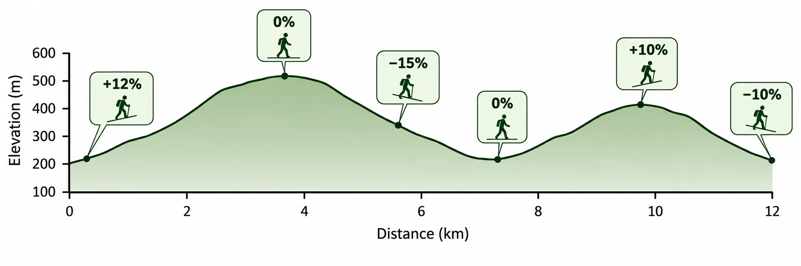{fig-alt="Illustrative hiking elevation profile over 12 kilometres, showing uphill, level, and downhill sections labelled with percentage gradients." height=400 fig-align="center" .nostretch}
:::

::: notes
~2 min. This is a useful empirical generalization, not an inviolable physical law. Nearby observations may be similar due to shared environments or interaction. Distant places can also be closely connected.

Use the hiking profile to bridge to the next slide's question: what counts as near? Equal distances can involve different movement effort across uphill, level, and downhill terrain. The gradient labels are percentages, not degrees: a 10% gradient means 10 m of vertical change per 100 m of horizontal distance. Treat this as a schematic illustration rather than a measured route or a source of precise slope estimates.

Keep the two Tobler ideas distinct. The quotation is his first law of geography; this hiking graphic concerns terrain and movement cost, associated with his separate work on hiking speed. It does not plot the hiking-speed function or directly demonstrate spatial autocorrelation. Here it prompts the question of whether straight-line distance captures the relationships that matter archaeologically.
:::

---

## What counts as 'near'?

::: {.center-block}
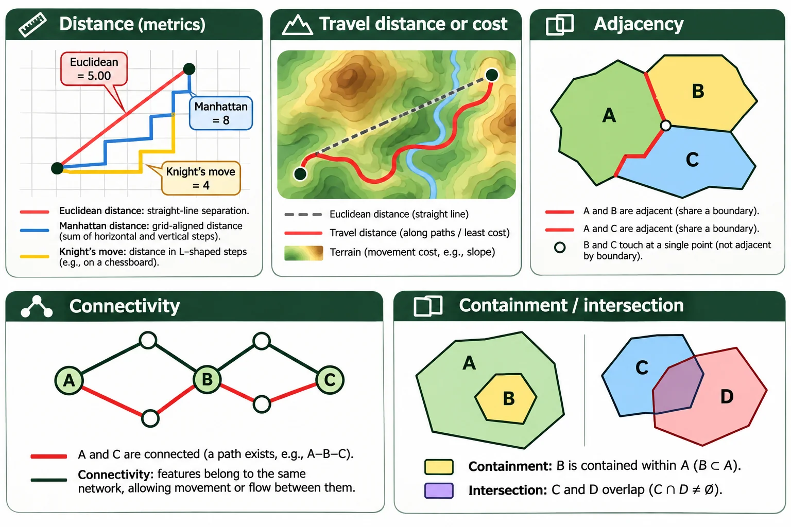{fig-alt="Five illustrated comparisons of distance metrics, travel cost across terrain, polygon adjacency, network connectivity, and containment or intersection." height=740 fig-align="center" .nostretch}
:::

::: notes
~2 min. A site across a river may be closer in straight-line distance but harder to reach. The appropriate spatial relation depends on the archaeological question.

Use the panels selectively rather than reading all their text. Start with straight-line separation versus travel through terrain: a longer route may take less time or effort. Travel distance and accumulated movement cost are different quantities; a least-cost route need not be the shortest path. The alternative grid metrics illustrate that distance depends on permitted movements. Treat the displayed paths and numbers as schematic, not a worked calculation.

Then distinguish neighbourhood from network connection. Adjacency needs a stated rule: polygons can be neighbours if they share an edge, or under a broader rule if they touch at a corner. The adjacency artwork is imperfect: B and C appear to share an edge despite the caption saying they touch at a single point. Explain the rule verbally rather than using that pair as an exact geometry example. Connected places need not be directly linked; a path can pass through intermediate nodes.

Finish with a site inside a survey area or two overlapping land-use polygons. Containment places one geometry inside another; intersection means they share some location and can include touching, not only overlap of polygon interiors. Ask which relationship would answer an archaeological question about access, survey coverage, or shared territory.
:::

---

## Spatial dependence and clustering

- Spatial observations are often **not independent**.
- Nearby sites may share environmental and historical influences.
- Apparent clusters can also arise from **survey coverage**.
- A mapped cluster is not automatically evidence of social interaction.

, [CC BY 4.0](https://creativecommons.org/licenses/by/4.0/); figure extracted from the page.](../assets/content/01-geospatial-archaeology/spatial-autocorrelation-westerholt.png){fig-alt="Three maps of the same Dortmund grid showing similar neighbouring values, a randomised arrangement, and contrasting neighbouring values." height=360 fig-align="center" .img-card}

::: notes
~2 min. Introduce spatial autocorrelation conceptually, without Moran's I. Ask what an observed distribution is being compared against.

Read left to right: positive autocorrelation means nearby values tend to be similar; the middle panel illustrates randomisation; negative autocorrelation means neighbouring values tend to contrast. These are population-grid examples from Dortmund based on the 2011 German Census, with spatial filtering used to construct panels a and c. They are not archaeological site distributions. The panels have different value ranges: compare spatial arrangements, not the same shade as if it represented the same number across all three legends.

Distinguish similarity of measured values from clustering of point locations. Archaeological examples of autocorrelated values might include neighbouring cells with similar artefact densities. A cluster of settlement points is a related but different spatial question. Neither pattern alone establishes interaction or causation. Neighbour definitions and scale matter; a global statistic near its null expectation also does not rule out local structure. Keep the mathematics for a later class.
:::

---

## Case study: are neighbouring houses contemporary?

:::: {.columns}
::: {.column width="40%"}
**Jōmon pithouses, Chiba New Town, Japan**

- Mapped houses appear in **clusters**.
- Excavated areas define where evidence was recovered.
- **Dating uncertainty** complicates comparisons through time.

**Question:** does proximity imply that households lived together?
:::
::: {.column width="60%" .h-center}
.](../assets/content/01-geospatial-archaeology/crema-bevan-lake-2010-fig2.jpg){fig-alt="Map of pithouses and excavation areas over elevation in Chiba New Town, Japan, with the Ariyoshi cluster sub-study area outlined." height=560 fig-align="center" .img-card}
:::
::::

::: notes
The case study examines prehistoric hunter-gatherer settlements in the Chiba New Town area, east of Tokyo, Japan, during the Middle-to-Late Jōmon transition (approximately 5000–3000 years ago). Jōmon communities were relatively sedentary hunter-gatherers who relied on fishing, hunting, and gathering, often living in settlements of semi-subterranean pit houses. During the Middle Jōmon, houses were commonly arranged in clustered, sometimes circular settlements, but archaeological evidence suggests a transition toward smaller, more dispersed and irregularly distributed residential units. This change may reflect broader social and economic transformations, including increased residential mobility and changes in how communities organized themselves across the landscape. The central archaeological question is whether settlement patterns genuinely became more dispersed through time, and what that implies about changing hunter-gatherer lifeways. Crema, Bevan, and Lake (2010) investigate this using the spatial distribution of 386 excavated pit houses, whose dates are inferred from pottery typology with varying degrees of precision. The challenge is determining whether apparent spatial changes reflect real historical processes or are partly artifacts of chronological uncertainty.

Point out pithouses, excavation boundaries, and the Ariyoshi sub-study area. This is a study-area map, not a statistical result. Crema and colleagues analyse Jōmon settlement patterns while accounting for uncertain chronology using probability weighting and simulation. Nearby houses need not have been occupied together. Ask what dates and observation coverage would be needed before interpreting a cluster as a community.

Reading: [Crema, Bevan & Lake (2010), author manuscript](https://discovery.ucl.ac.uk/id/eprint/148634/1/148634_Cremaetal10_postprint.pdf).
:::

---

## Simple clustering statistics: Moran's I

**Question:** do neighbouring survey squares have similar artefact counts?

:::: {.columns}
::: {.column width="48%"}
**Four equal-area squares in a row**

| Square | A | B | C | D |
|:--|--:|--:|--:|--:|
| Count | 2 | 2 | 8 | 8 |
| Count − mean | −3 | −3 | +3 | +3 |

Mean = **5**. Neighbours: **A–B, B–C, C–D**.

Equal survey effort; each neighbour link has weight **1**.
:::
::: {.column width="52%"}
**Multiply neighbouring deviations**

- A–B: $(−3)(−3) = +9$
- B–C: $(−3)(+3) = −9$
- C–D: $(+3)(+3) = +9$

Count both directions: $2(9-9+9)=18$.

Sum of squared deviations: $4\times9=36$.

$$I=\frac{4}{6}\times\frac{18}{36}=\boxed{\frac{1}{3}}$$
:::
::::

::: {.callout-card}
**Positive I: similar values tend to be neighbours. Statistical significance needs a comparison with random rearrangements.**
:::

::: {.reference}
Invented example. Method: [Global Moran's I, Esri documentation](https://doc.esri.com/en/arcgis-pro/latest/tool-reference/spatial-statistics/h-how-spatial-autocorrelation-moran-s-i-spatial-st.html).
:::

::: notes
~3 min. This is spatial autocorrelation of an attribute measured at fixed locations, rather than unmarked point-pattern analysis of where sites occur. The counts are invented and assume equal-sized squares, comparable detection, and equal effort. In a field application we would check those assumptions or choose an appropriately adjusted variable.

Walk along A–B–C–D. With mean 5, low counts have negative deviations and high counts positive deviations. Multiplying deviations gives a positive contribution for low–low or high–high neighbours and a negative contribution for a low–high pair. Two same-value links outweigh the contrasting middle link here.

The general formula is I = (n / S₀) × [ΣᵢΣⱼ wᵢⱼ(xᵢ − mean)(xⱼ − mean)] / [Σᵢ(xᵢ − mean)²]. Here n = 4. Use symmetric binary weights, no self-neighbours, and no row standardisation: only adjacent squares are linked. There are three undirected links, counted in both directions in the double sum, giving S₀ = 6. The numerator is 18 and the denominator 36, so I = 1/3. Explicitly identify 4 as the number of squares and 6 as the total weight to prevent the prefactor seeming arbitrary.

Interpret this as a positive autocorrelation score for this neighbourhood definition, not a correlation of 33%, a p-value, proof of interaction, or a demonstrated significant cluster. A randomisation test keeps locations and links fixed and rearranges the observed counts. Under the usual randomisation null with no self-weights, expected I is −1/(n−1), here −1/3, rather than exactly zero. This tiny example explains the arithmetic and has little inferential power. Do not present −1 and +1 as universal fixed bounds for every weights matrix.

Optional verbal contrast: rearranging the same counts as 2, 8, 2, 8 makes all three neighbour products negative and gives I = −1 with these particular weights. Neighbour definitions and weight standardisation change the calculation, so state them. No need to introduce local Moran statistics here.
:::

---

## FUNDAMENTAL GIS OPERATIONS {.section-slide background-image="../assets/branding/section_bg.png" background-size="cover" background-position="center"}

---

## Buffer and distance

:::: {.columns}
::: {.column width="52%"}
**Buffer:** construct a zone within a specified distance of features.

**Distance:** measure separation from features or locations.

*Example:* Which archaeological sites lie within 500 m of mapped rivers?
:::
::: {.column width="48%" .h-center}
.](../assets/content/01-geospatial-archaeology/qgis-buffer1.png){fig-alt="QGIS diagram showing circular buffers around points, a corridor around a line, and outward and inward polygon buffers." width="95%" fig-align="center" .img-card}
:::
::::

::: notes
~2 min. Distances should be calculated with appropriate units and CRS. A buffer does not imply that people historically travelled in straight lines.

Read the diagram from left to right: point buffers form discs; a line buffer forms a corridor; a positive polygon buffer expands its footprint; a negative polygon buffer contracts it. A 500 m river buffer extends 500 m on each side of a line representation, not 250 m per side. Overlapping buffers can remain separate or be dissolved into one zone. Select or spatially join site points against the buffer to answer the example question. Modern mapped rivers may differ from ancient waterways, so the geometric result still needs historical interpretation.
:::

---

## Clip, intersect, and spatial join

- **Clip:** retain the portion of data inside a study boundary.
- **Intersect / overlay:** find the geographic overlap of layers.
- **Spatial join:** attach attributes based on spatial relationships.

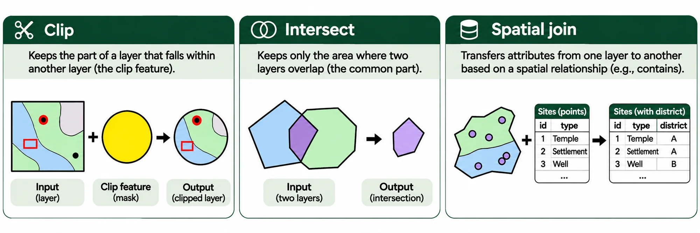{fig-alt="Three-panel diagram showing a layer clipped to a mask, overlapping polygons intersected, and district attributes joined to archaeological site points." fig-align="center" height=500 .nostretch}

::: notes
~3 min. Example: clip a soil map to the survey region, intersect settlement polygons with soil types, or attach geology attributes to site points. Mention that joins may create multiple matches.

Read the graphic left to right. Clip uses a boundary as a cookie cutter: in a vector clip, keep input geometry inside the mask and retain the input attributes. A vector intersection creates the shared geometry and can carry attributes from both inputs. A spatial join generally retains the target geometry and adds information from matching features, as in the illustrated district column added to the site table. Joins can also summarise matches, such as counting sites per district.

Distinguish changing geometry from attaching attributes. A spatial join does not cut a settlement polygon into soil zones; intersection can do that. State the relationship used for a join, such as within or intersects. Points on boundaries, overlapping polygons, or several candidate matches require a rule; do not assume exactly one match per feature. The graphic is schematic, not a complete dataset or a precise coordinate overlay.
:::

---

## Working with raster values

- **Sample:** retrieve elevation at each site.
- **Derive:** calculate slope from a DEM.
- **Summarize:** mean elevation within a survey polygon (zonal statistics).
- **Combine:** raster calculations or classifications.

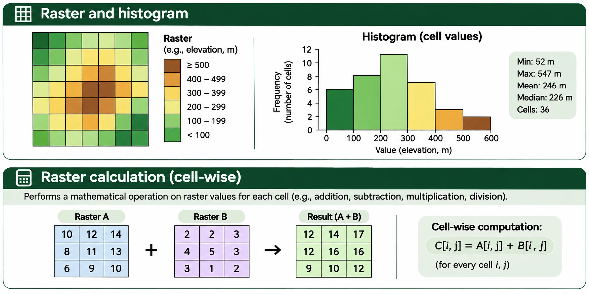{fig-alt="Illustration of a raster and its value histogram, followed by cell-wise addition of two three-by-three rasters." height=560 fig-align="center" .nostretch}

::: notes
~2 min. Raster values are cell-based estimates. Elevation at a point inherits the DEM's resolution and measurement limitations.

Use the top panel to distinguish spatial arrangement from the distribution of values: the histogram counts values in bins but does not show where those cells are. A mean over a survey polygon is a zonal summary; its boundary defines which cells contribute. NoData must be handled explicitly rather than treated as zero.

In the lower panel, compare matching cells: the top-left result is 10 + 2 = 12. A meaningful cell-wise calculation requires compatible units and spatially aligned grids, including CRS, cell size, and origin. Software may resample mismatched grids; check that decision rather than assuming row and column indices alone identify the same places. Slope is different from the illustrated addition: it uses neighbouring elevations, not just one cell's value.

The top panel is schematic and internally inconsistent: the drawn grid has 7 × 7 = 49 cells, while the summary says 36. Do not use its histogram or listed summary values as a verified numerical exercise. The lower-panel addition can be used as the worked arithmetic example.
:::

---

## A simple analysis is already possible

**Question:** Are recorded settlements associated with a particular soil type?

1. Load **site locations** and **soil polygons**.
2. Confirm their **CRSs**.
3. **Spatially join** soil categories to sites.
4. Count sites by category.
5. Compare with the **area and survey effort** in each category.

::: notes
~2 min. Raw site counts are not enough: abundant soil types and better-surveyed areas will naturally contain more recorded sites. This is the bridge to inference.
:::

---

## SCALE, TIME, AND UNCERTAINTY {.section-slide background-image="../assets/branding/section_bg.png" background-size="cover" background-position="center"}

---

## Resolution, precision, accuracy

::: {.center-block}
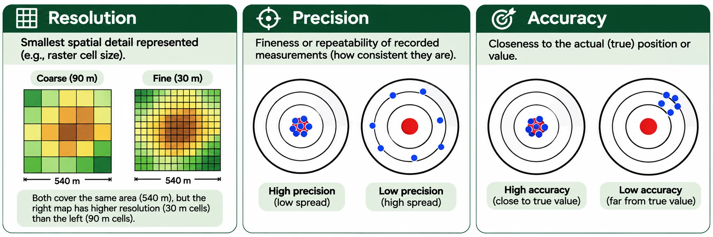{fig-alt="Three-panel comparison of raster resolution, measurement precision shown by target-point spread, and accuracy shown by proximity to the target centre." height=560 fig-align="center" .nostretch}
:::

::: {.callout-card}
**Eight decimal places do not guarantee an accurately located archaeological site.**
:::

::: notes
~2 min. Contrast precise-looking GPS coordinates with uncertain site location. A 30 m raster cannot resolve 2 m features; higher display zoom does not create new information.

Read left to right. Resolution concerns the spatial detail represented: smaller cells can represent finer variation over the same extent when supported by the source data. Treat the drawn grids as schematic, not as a numerically exact cell-count exercise for the labelled dimensions.

Precision in the target example means repeatability: tightly grouped measurements have little spread. Accuracy concerns closeness to the true position, represented by the target centre. The offset cluster on the far right is precise but inaccurate, illustrating systematic error. These properties are distinct: repeated GPS fixes can agree closely while all being displaced from a surveyed control point. More decimal places describe numerical fineness, not evidence of repeatable or accurate measurement.

Ask which problem would be fixed by collecting more decimal places: none of the underlying location errors. Improving accuracy needs better observations, control, or correction of systematic error. A finer output raster likewise does not repair inaccurate input measurements. Keep the distinction tied to archaeological examples such as uncertain findspots, survey control, and terrain models.
:::

---

## Scale changes the pattern

::: {.center-block}
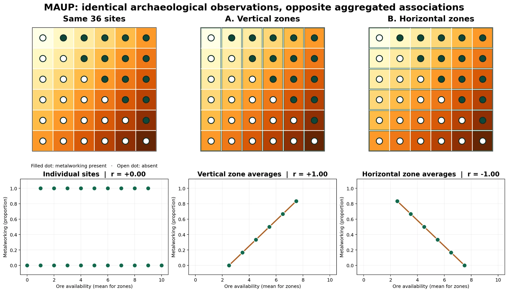{fig-alt="Schematic MAUP example with the same 36 sites: individual ore availability and metalworking have zero correlation, while vertical-zone averages give a positive correlation and horizontal-zone averages a negative correlation." height=730 fig-align="center" .nostretch}
:::

**MAUP — Modifiable Areal Unit Problem:** results depend on how observations are grouped into areas.

::: notes
~2 min. This is a constructed example, not an archaeological dataset. Start at the left: the 36 site observations are identical across all panels. Background colour represents ore availability; filled dots indicate metalworking and open dots its absence. At site level, the illustrated association is zero.

In the middle, aggregate into vertical strips. Each strip contributes its mean ore availability and proportion of sites with metalworking. Those six pairs show a positive association. On the right, aggregate the very same observations into horizontal strips and the association reverses. The plotted r values describe different units of analysis: 36 sites versus six zone summaries. No archaeological observations changed; the grouping changed.

This specifically illustrates the zoning component of MAUP: zones have comparable size and the same number of sites, but their boundaries group observations differently. The scale component concerns changing the size or number of aggregation units. Both can affect inferred patterns. Do not claim that this example demonstrates causation, that every aggregation reverses a correlation, or that an area-level association necessarily applies to individual sites: the latter inference risks an ecological fallacy.

Ask: would we conclude that ore attracts or repels metalworking if we saw only one aggregated plot? Choose spatial units with an archaeological rationale and examine sensitivity to alternative sizes and boundaries, rather than selecting the arrangement that produces a preferred result.
:::

---

## Archaeological maps also have time

:::: {.columns}
::: {.column width="50%"}
- Features on the same map may **not have coexisted**.
- Chronological assignments can be broad or uncertain.
- Landscape features (rivers, shorelines, roads) **change through time**.
- A spatial pattern without temporal control can be misleading.
:::
::: {.column width="50%" .h-center}
.](../assets/content/01-geospatial-archaeology/crema-bevan-lake-2010-fig1.jpg){fig-alt="Space-time diagram showing archaeological events with different timings and durations projected into one observed spatial pattern." height=580 fig-align="center" .img-card}
:::
::::

::: notes
~2 min. Explain the palimpsest problem. A GIS layer of all known sites is often a cumulative record, not a snapshot of a historical landscape.

The vertical axis is time, rather than elevation. Events within a selected time block are collapsed onto a spatial plane. Single episodes, repeated activity, and long-duration occupation can therefore appear equivalent in the mapped pattern. Relate this to the earlier pithouse example: locations alone cannot establish a contemporary community. Ask what changes if we narrow the time window.
:::

---

## The archaeological observation process

:::: {.columns}
::: {.column width="45%"}
**Past activity → preservation → discovery → recording → GIS layer**

- Preservation is spatially variable.
- Surveys do not cover all areas equally.
- Detection and classification are imperfect.
:::
::: {.column width="55%" .h-center}
.](../assets/content/01-geospatial-archaeology/ireland_roadscheme_archaeology.PNG){fig-alt="Excerpt from Michael Stanley's article beside a map of Ireland with archaeological discoveries forming conspicuous linear corridors." height=500 fig-align="center" .img-card}
:::
::::

::: {.callout-card}
**A distribution of recorded sites is not necessarily a distribution of past activity.**
:::

::: notes
~2 min. This is arguably the most important interpretive warning. Site absences may be absences of observation rather than evidence of no occupation.

Use Stanley's “Spot the road scheme” example to ask what produces the conspicuous corridors of discoveries. Road construction creates opportunities for archaeological investigation, so the distribution of recorded evidence can reflect modern development and excavation coverage as well as past activity. Do not read the lines of dots as ancient routes on the basis of this map alone.

Follow the sequence on the left: archaeology must survive, be encountered, be recognised, and enter the record before it appears in GIS. Development-led archaeology adds valuable evidence, but its spatial coverage is shaped by where development occurs. A blank area away from an investigated corridor is not equivalent to an excavated area with no finds. Ask students what coverage information they would want before comparing site densities across Ireland.

Article metadata cross-checked against [Irish History Online](https://www.iho.ie/index.php?iho_function=1&iho_identifier=100336) and the [journal's Autumn 2017 issue](https://archaeologyireland.ie/recent-issues/autumn-2017/); the caption links to the supplied JSTOR record.
:::

---

## AN ARCHAEOLOGICAL WORKFLOW {.section-slide background-image="../assets/branding/section_bg.png" background-size="cover" background-position="center"}

---

## Example: settlements and waterways

**Research question:** Were settlements preferentially located near waterways?

 and [EPA](https://data.gov.ie/dataset/river-network-routes), CC BY 4.0.](../assets/content/01-geospatial-archaeology/ringforts_ennis_waterways.png){fig-alt="Map of recorded ringfort points and modern river routes in a small study area around Ennis, County Clare, with a kilometre scale bar and grid north arrow." fig-align="center" height=620 .img-card}

::: notes
~2 min. This map is generated by notebooks/ringforts_rivers_setup.qmd from the small-area Ennis downloads. It combines recorded ringfort points with EPA modern river routes in Irish Transverse Mercator (EPSG:2157). Explain the question before any tools: are ringforts preferentially located near waterways, compared with appropriate background locations?

The map is descriptive, not a test of preference. The ringfort classes combine raths, cashels, and unclassified records; this is not a map of every kind of settlement or a single contemporary population. NMS locations are approximate centroids, and the hydrography is modern. Displayed rivers are clipped to the teaching rectangle; any later nearest-river analysis needs surrounding coverage to avoid edge effects. Point out the two layers, legend, and projected scale before discussing buffers and distances.
:::

---

## From question to GIS operations

1. Obtain **settlement locations**, **waterways**, and **study-area boundary**.
2. Check **coordinates, CRSs, and attributes**.
3. Calculate **distance to nearest waterway**.
4. Compare site distances with **appropriate background locations**.
5. Examine sensitivity to **chronology, survey coverage, and historic hydrology**.

::: notes
~3 min. A map or list of distances is a descriptive result. A preference claim requires comparison with where settlements could have been and could have been observed.
:::

---

## Results: distances to the nearest waterway

 and [EPA](https://data.gov.ie/dataset/river-network-routes), CC BY 4.0.](../assets/content/01-geospatial-archaeology/ringforts_ennis_distance_histograms.png){fig-alt="Overlaid translucent histograms comparing nearest-waterway distances for recorded ringforts and uniform random points within the same study boundary." height=650 fig-align="center" .img-card}

**Where do the distributions overlap, and where do they differ?**

::: notes
~2–3 min. This figure implements steps 3 and 4 from the previous slide. The notebook measures straight-line distances in Irish Transverse Mercator to the full river geometries, including surrounding coverage. It compares ringforts within the same display polygon with 5,000 uniform random locations sampled by projected area. A fixed random seed makes this background reproducible.

Both groups share bin edges and the same distance axis. Heights are percentages of each group, so the larger random sample does not automatically produce taller bars. Transparency lets students see overlap. Start with the axis labels, then invite observations about the short-distance bins and the tails. Describe what the actual distributions show rather than assuming that ringforts must be closer to water.

This is a descriptive comparison, not a significance test or evidence that water caused settlement choices. Uniform background points represent space within this teaching boundary, not a model of where ringforts could have been built, preserved, or discovered. The network is modern; monument dates, survey coverage, soils, terrain, and historical changes remain relevant. Use the next slide to discuss those interpretive questions; no further statistical analysis is needed here.
:::

---

## Interpretation is not an automatic GIS output

**Finding:** Many mapped sites are near rivers.

**Does this mean rivers caused settlement locations?**

- Are rivers common across the study region?
- Were other locations surveyed?
- Did these rivers exist during occupation?
- Could elevation, soils, or transport networks explain the pattern?

::: {.callout-card}
**GIS can calculate a relationship; archaeology must justify its interpretation.**
:::

::: notes
~2 min. Invite one or two student answers. The software does not choose a defensible null model or establish causation.
:::

---

## The basic GIS workflow

::: {.center-block .gis-workflow}
```{mermaid}
%%| fig-align: center
%%| out-width: 100%
%%| fig-alt: "GIS workflow from question through data, checking and alignment, analysis, validation, interpretation, and communication, with a feedback loop from validation to checking inputs."
%%{init: {"theme": "base", "themeVariables": {"fontFamily": "Arial, sans-serif", "fontSize": "24px", "lineColor": "#718781", "edgeLabelBackground": "#ffffff"}, "flowchart": {"htmlLabels": false, "curve": "basis", "nodeSpacing": 35, "rankSpacing": 25, "padding": 40}}}%%
flowchart LR
    Q("01 · Question<br/>Define the problem")
    D("02 · Data<br/>Gather evidence")
    C("03 · Check & align<br/>CRS · units · quality")
    A("04 · Analyse<br/>Measure patterns")
    V("05 · Validate<br/>Check the results")
    I("06 · Interpret<br/>Explain in context")
    M("07 · Communicate<br/>Map & tell the story")

    Q --> D --> C --> A --> V --> I --> M
    V -. Revise inputs .-> C

    classDef endpoint fill:#006c66,color:#ffffff,stroke:#006c66,stroke-width:2px,rx:14,ry:14;
    classDef process fill:#f0f5f3,color:#243e36,stroke:#b9cec7,stroke-width:1.5px,rx:14,ry:14;
    classDef check fill:#e8f1f8,color:#204b6d,stroke:#8db2d1,stroke-width:1.5px,rx:14,ry:14;
    class Q,M endpoint;
    class D,A,I process;
    class C,V check;
```
:::

::: {.callout-card}
**The workflow is iterative: checking a result can send us back to the data.**
:::

::: notes
~1 min. Recap the whole lecture as a workflow. Checking data and interpreting output are essential steps, not optional extras.

Follow the main arrows from the archaeological question to communication. Use the Ennis example to make each step concrete: recorded ringforts and modern rivers; coordinates and coverage checks; nearest-waterway distances; checks on edge effects and background sampling; interpretation in light of survey and chronology; a map and a histogram for discussion. The dashed arrow represents revisiting inputs when validation reveals a problem. Other stages can also require revision: the loop is illustrative, not the only permitted route back through the workflow.
:::